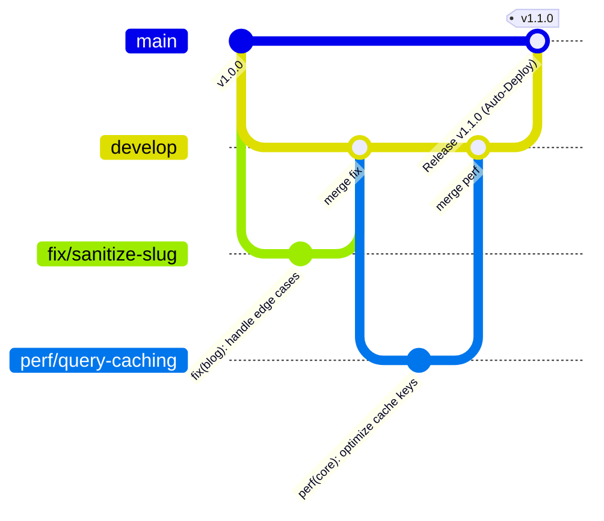

# Contribution Guidelines — The Last Blog in the World

> **English** | [Versão em Português](CONTRIBUTING.md)

Thank you for your interest in contributing to **The Last Blog in the World**! This document defines the Git workflow, commit conventions, and code quality standards used in this project.

---

## 🌿 Branch Workflow: Simplified Gitflow (`develop` ➔ `main`)

Following the release of version `v1.0.0`, the project operates under a continuous, protected branch workflow:



### Branch Rules:
- **`main` (Protected Production)**:
  - Always stable and deployable.
  - **Automated deployment to Render occurs exclusively upon merging into `main`**.
  - Direct commits are prohibited; only approved merges originating from `develop` are allowed.
- **`develop` (Active Integration & Staging)**:
  - Default branch for ongoing development post-v1.0.0.
  - All improvements, bug fixes, and new articles are integrated and validated by CI here before going to production.
- **Working Branches (branched from `develop`)**:
  - `fix/<slug>`: Bug fixes
  - `perf/<slug>`: Performance optimizations and caching
  - `feat/<slug>`: New features
  - `docs/<slug>`: Documentation and articles
  - `chore/<slug>`: Dependency maintenance and tooling

### Release Strategy (Hybrid Governance):
- **Patch Releases (`v1.0.1`, `v1.0.2`)**: Critical bug fixes and small adjustments can be merged from `develop` to `main` as soon as they pass CI.
- **Minor Releases (`v1.1.0`, `v1.2.0`)**: Consolidated batches of new features or major performance overhauls are merged with `--no-ff` into `main`, tagged, and recorded in `CHANGELOG.md`.

---

## 📝 Conventional Commits

All commit messages must follow the English imperative convention:

**Format**: `<type>(<scope>): <description in imperative>`

### Accepted Types:
- `feat` — New feature
- `fix` — Bug fix
- `perf` — Performance improvement / optimization
- `docs` — Documentation
- `style` — Formatting (no logic change)
- `refactor` — Refactoring without behavioral change
- `test` — Adding or updating tests
- `chore` — Maintenance tasks or dependency updates
- `ci` — Changes to CI pipelines and GitHub Actions workflows
- `build` — Changes to Dockerfile, compose, or requirements

### Recommended Scopes:
- `blog`, `dashboard`, `core`, `accounts`, `ci`, `docker`, `docs`, `perf`, `auth`

### Valid Examples:
- `fix(blog): ensure slug collision prevention for drafts`
- `perf(dashboard): add select_related to media list view`
- `docs(readme): add roadmap.sh credits and clarify personal scope`
- `ci: enable concurrency cancel in action workflows`

---

## 🎨 Code Style & Quality Verification

- **Python**: Formatted and linted with **Ruff** (configuration in `pyproject.toml`).
- **Commits & Code**: In English (global industry standard).
- **User Documentation**: Bilingual (English & Portuguese).
- **PR Pre-requisites**:
  ```bash
  # Check lint and formatting
  ruff check .
  ruff format --check .

  # Run test suite with minimum 80% coverage
  pytest --cov --cov-report=term-missing --cov-fail-under=80
  ```

---

## 🚀 Pull Requests

1. Create your branch from `develop`: `git checkout -b feat/your-feature develop`.
2. Write atomic, descriptive commits.
3. Ensure automated tests cover your changes.
4. Open the PR targeting the **`develop`** branch.
