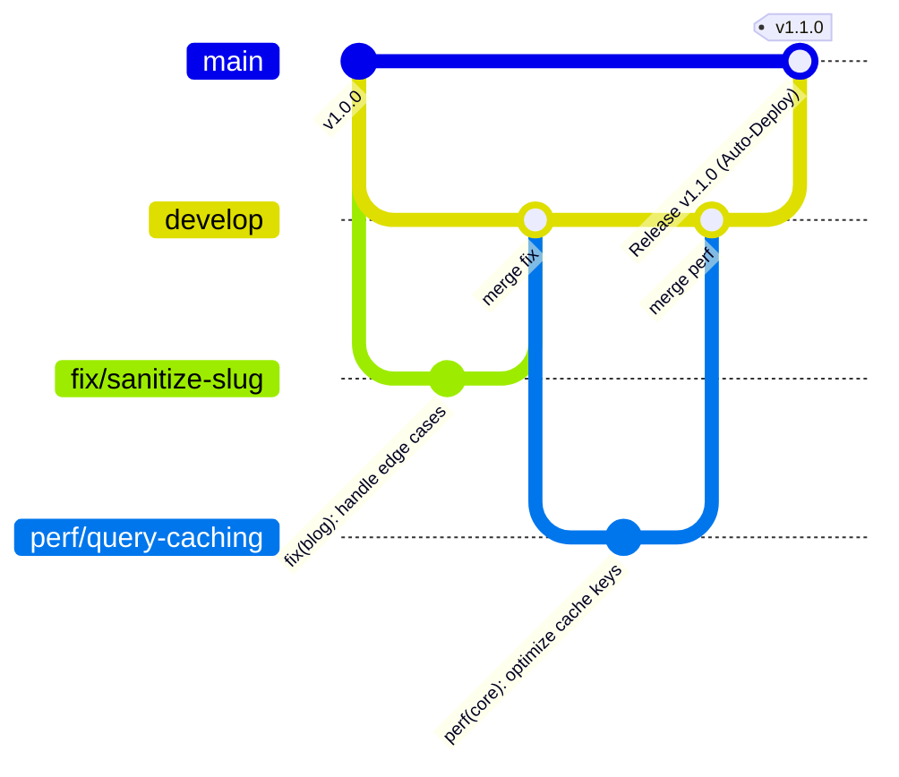

# Guia de Contribuição — O Último Blog do Mundo

> [English Version](CONTRIBUTING.en.md) | **Português**

Obrigado pelo interesse em contribuir com **O Último Blog do Mundo**! Este documento estabelece o fluxo de trabalho git, convenções de commits e padrões de código adotados no projeto.

---

## 🌿 Fluxo de Branches: Gitflow Simplificado (`develop` ➔ `main`)

Após o lançamento da versão `v1.0.0`, o projeto adota um fluxo de branches contínuo e protegido:



### Regras das Branches:
- **`main` (Produção Protegida)**:
  - Sempre estável e pronta para deploy.
  - **O deploy automático no Render ocorre exclusivamente quando há merge na `main`**.
  - Não recebe commits diretos; apenas merges autorizados originados da `develop`.
- **`develop` (Integração & Homologação)**:
  - Branch padrão para desenvolvimento contínuo pós-v1.0.0.
  - Todas as melhorias, correções de bugs e novos artigos são integrados e testados pelo pipeline CI nela antes de irem para produção.
- **Branches de Trabalho (ramificadas a partir da `develop`)**:
  - `fix/<slug>`: Correções pontuais de bugs
  - `perf/<slug>`: Otimizações de desempenho e caching
  - `feat/<slug>`: Novas funcionalidades
  - `docs/<slug>`: Alterações em documentação e artigos
  - `chore/<slug>`: Manutenção de dependências e tooling

### Ciclo de Releases (Governança Híbrida):
- **Patch Releases (`v1.0.1`, `v1.0.2`)**: Correções de bugs e ajustes pontuais podem ser mesclados de `develop` para `main` assim que validados no CI.
- **Minor Releases (`v1.1.0`, `v1.2.0`)**: Pacotes consolidados de novas features ou grandes melhorias de desempenho são mesclados com `--no-ff` na `main`, gerando tag e nota no `CHANGELOG.md`.

---

## 📝 Conventional Commits

Todas as mensagens de commit devem seguir a convenção em inglês:

**Formato**: `<tipo>(<escopo>): <descrição no imperativo>`

### Tipos aceitos:
- `feat` — Nova funcionalidade
- `fix` — Correção de bug
- `perf` — Melhoria de desempenho / otimização
- `docs` — Documentação
- `style` — Formatação (sem alteração de lógica)
- `refactor` — Refatoração sem mudança de comportamento
- `test` — Criação ou ajuste de testes
- `chore` — Tarefas de manutenção ou dependências
- `ci` — Mudanças em pipelines e workflows do GitHub Actions
- `build` — Alterações em Dockerfile, compose ou requirements

### Escopos recomendados:
- `blog`, `dashboard`, `core`, `accounts`, `ci`, `docker`, `docs`, `perf`, `auth`

### Exemplos válidos:
- `fix(blog): ensure slug collision prevention for drafts`
- `perf(dashboard): add select_related to media list view`
- `docs(readme): add roadmap.sh credits and clarify personal scope`
- `ci: enable concurrency cancel in action workflows`

---

## 🎨 Estilo de Código & Validação

- **Python**: Formatado e auditado via **Ruff** (configuração em `pyproject.toml`).
- **Commits e Código**: Em inglês (padrão de mercado para portfólio global).
- **Documentação para Usuários**: Bilíngue (Português e Inglês).
- **Pré-requisito para PR**:
  ```bash
  # Verificar lint e formatação
  ruff check .
  ruff format --check .

  # Rodar suíte de testes com cobertura mínima de 80%
  pytest --cov --cov-report=term-missing --cov-fail-under=80
  ```

---

## 🚀 Pull Requests

1. Crie sua branch a partir de `develop`: `git checkout -b feat/sua-feature develop`.
2. Escreva commits atômicos e descritivos.
3. Garanta que testes novos foram adicionados cobrindo sua funcionalidade.
4. Abra o PR apontando para a branch **`develop`**.
