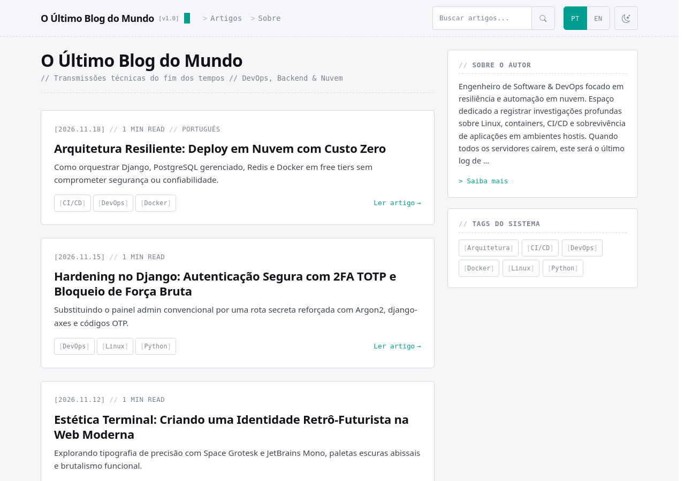
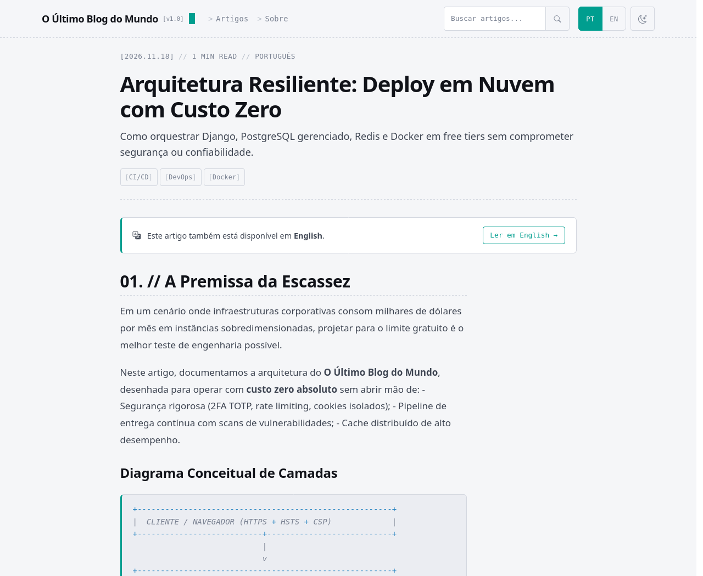
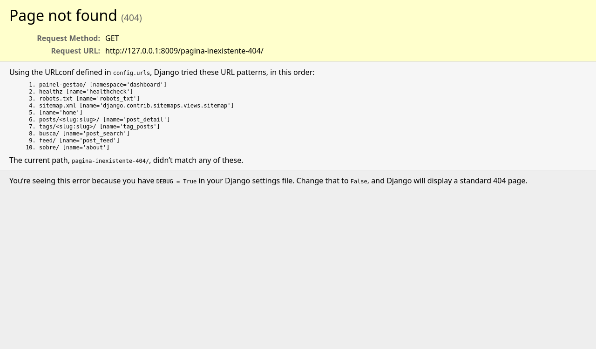
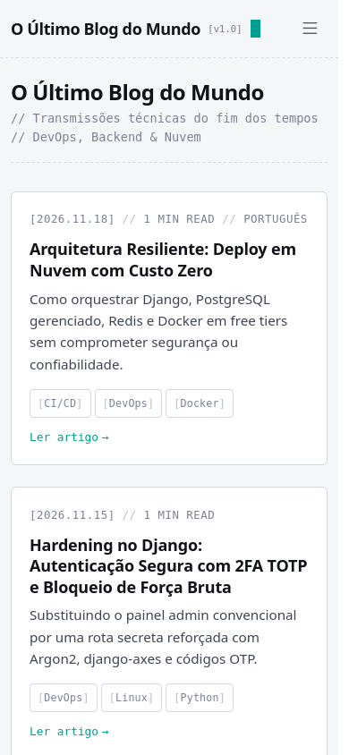

# The Last Blog in the World (O Último Blog do Mundo)

> **English** | [Versão em Português](README.md)

[](https://github.com/Luiz-Edu0202/o-ultimo-blog-do-mundo/actions/workflows/ci.yml)
[](https://github.com/Luiz-Edu0202/o-ultimo-blog-do-mundo/actions/workflows/keep_alive.yml)
[](https://github.com/Luiz-Edu0202/o-ultimo-blog-do-mundo/actions/workflows/backup.yml)
[](LICENSE)
[](https://www.python.org/)
[](https://www.djangoproject.com/)
[](Dockerfile)

Welcome to **The Last Blog in the World**! This is my personal blog and also an engineering portfolio project where I demonstrate modern back-end development, automation, and cloud infrastructure practices.

The original idea for this project was inspired by the [roadmap.sh — Personal Blog](https://roadmap.sh/projects/personal-blog) challenge.

---

## 💡 About the Project & Goals

I built this project with two complementary objectives:

1. **My Personal Space**: A blog to publish anything I feel like sharing — thoughts, ideas, book notes, reflections, daily life experiments, as well as technical articles.
2. **Hands-on DevOps & Back-end Portfolio**: A production-grade demonstration of a resilient, secure application featuring multi-stage Docker builds, automated CI/CD pipelines, comprehensive testing (>90% coverage), 2FA TOTP authentication, and zero-downtime deployment operating with **permanent zero cost**.

Developed by **[Luiz](https://github.com/Luiz-Edu0202)** ([LinkedIn](https://linkedin.com/in/luizbrayner)).

---

## 📸 Visual Showcase

The blog features a distinct **Soft Cyberpunk / Retro-Futuristic Terminal** aesthetic with locally-served typography and a fluid mobile-first experience:

| Desktop View (Dark Mode) | Article Reading (Typography & Code) |
|:---:|:---:|
|  |  |

| 404 Page (ASCII Terminal) | Mobile Viewport (iPhone 14) |
|:---:|:---:|
|  |  |

---

## 🛠️ Tech Stack

- **Language & Framework**: Python 3.12 + Django 6.1.x
- **Database**: SQLite (local dev) / PostgreSQL 16 with PgBouncer on Supabase (production)
- **Cache & Sessions**: Redis 7 managed on Upstash with TLS (8-hour isolated admin sessions)
- **Media Storage**: Supabase Storage via S3 API (`django-storages[s3]` + `boto3`)
- **WSGI Server & Static Files**: Gunicorn + WhiteNoise (Brotli/Gzip compression)
- **Design System & Typography**: Space Grotesk, Inter, and JetBrains Mono served locally (WOFF2)
- **Security**: Argon2 hasher, 2FA TOTP (`django-otp`), IP brute-force protection (`django-axes`), no exposed Django admin
- **Quality & CI/CD**: Ruff, pytest (104 tests, 92.7% coverage), Trivy, pip-audit, Docker Buildx, and GitHub Actions
- **Hosting**: Render Web Service (automated deploy hook from multi-stage Dockerfile)

---

## ⚡ Quickstart in 2 Minutes

### Option 1: Using Docker Compose (Recommended)

```bash
# 1. Copy environment variables template
cp .env.example .env

# 2. Build and start containers (Web + PostgreSQL 16 + Redis 7)
make up

# 3. Run migrations and populate realistic demo data
make migrate
make seed-docker

# Access:
# Public Blog: http://localhost:8000/
# Healthcheck: http://localhost:8000/healthz
```

### Option 2: Locally without Docker (SQLite)

```bash
# 1. Activate virtual environment and install dependencies
python3 -m venv .venv
source .venv/bin/activate
pip install -r requirements/local.txt

# 2. Configure environment and run
cp .env.example .env
make run
# In another terminal:
make seed
```

---

## 📚 In-Depth Technical Guides

To keep this showcase clean and concise, detailed engineering documentation is modularized in specialized guides:

- 🏛️ **[System Architecture](docs/en/architecture.md)**: Full Mermaid topology diagram, data flows, and technical justifications.
- 🔒 **[Security Policies & Hardening](docs/en/security.md)**: Threat model, Argon2, 2FA TOTP, django-axes rate-limiting, nh3 sanitization, and CI security audits.
- 🛠️ **[Operations, Backups & Free Tiers](docs/en/operations.md)**: Backup routines with `pg_dump`, disaster recovery, rollbacks, and free-tier dormancy mitigation via `keep_alive.yml`.
- 🤝 **[Contributing & Git Workflow](CONTRIBUTING.en.md)**: Contribution guidelines, commit conventions, and the `develop` ➔ `main` branch model.

---

## 🗺️ Future Roadmap

- [ ] 🐛 **Continuous bug fixes and edge case stabilization**
- [ ] ⚡ **Ongoing performance optimizations** (database queries, profiling, layered caching, and response times)
- [ ] ☸️ **Kubernetes Orchestration**: Bare-metal / home-lab deployment with k3s and GitOps (companion project)
- [ ] 📊 **Comprehensive Observability**: Prometheus metrics exporter, Grafana dashboards, and Loki log aggregation
- [ ] 🌐 **Edge CDN**: Global content delivery with dynamic caching via edge workers

---

## 📄 License

Distributed under the MIT License. See [`LICENSE`](LICENSE) for details.
