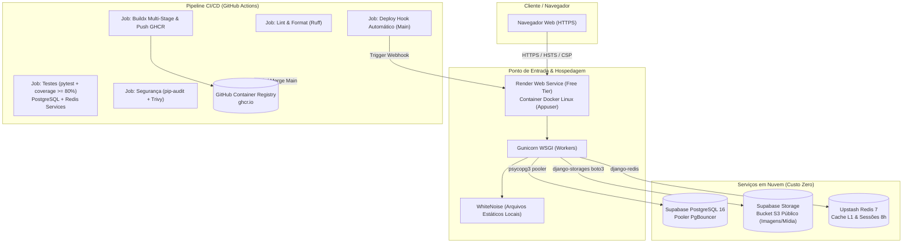
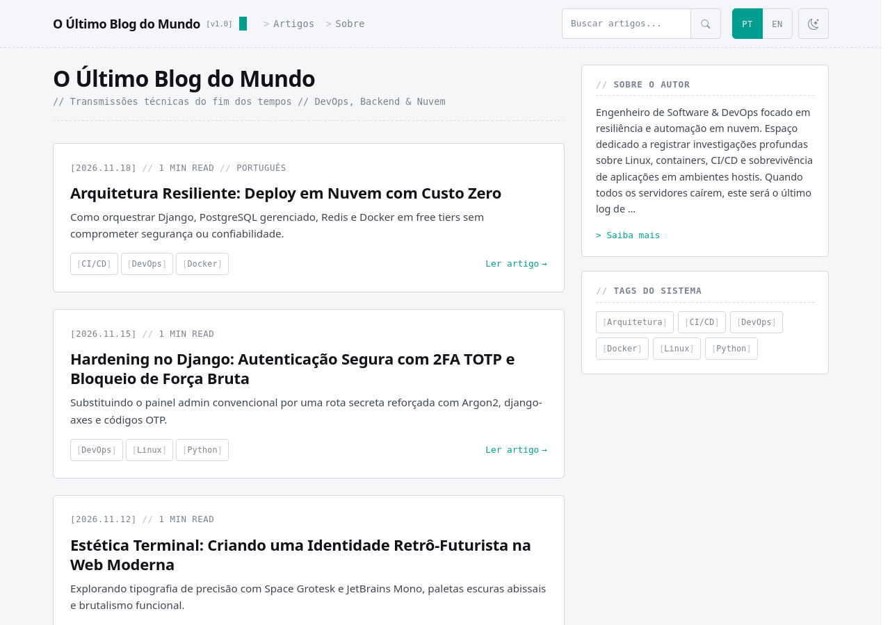
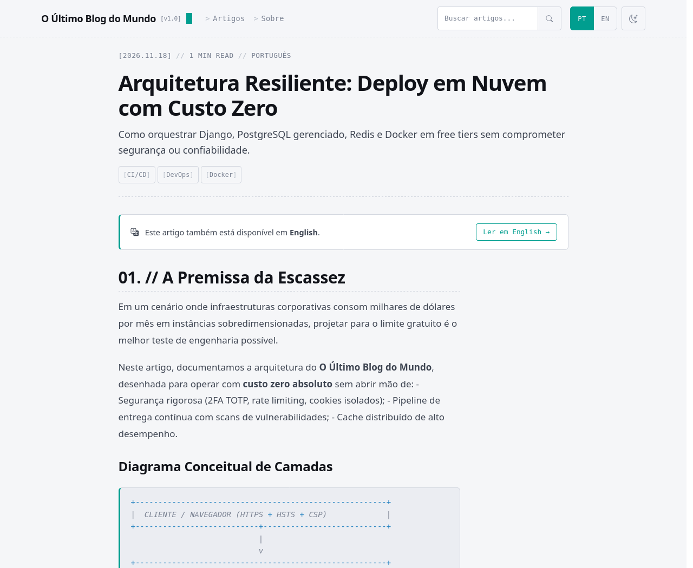
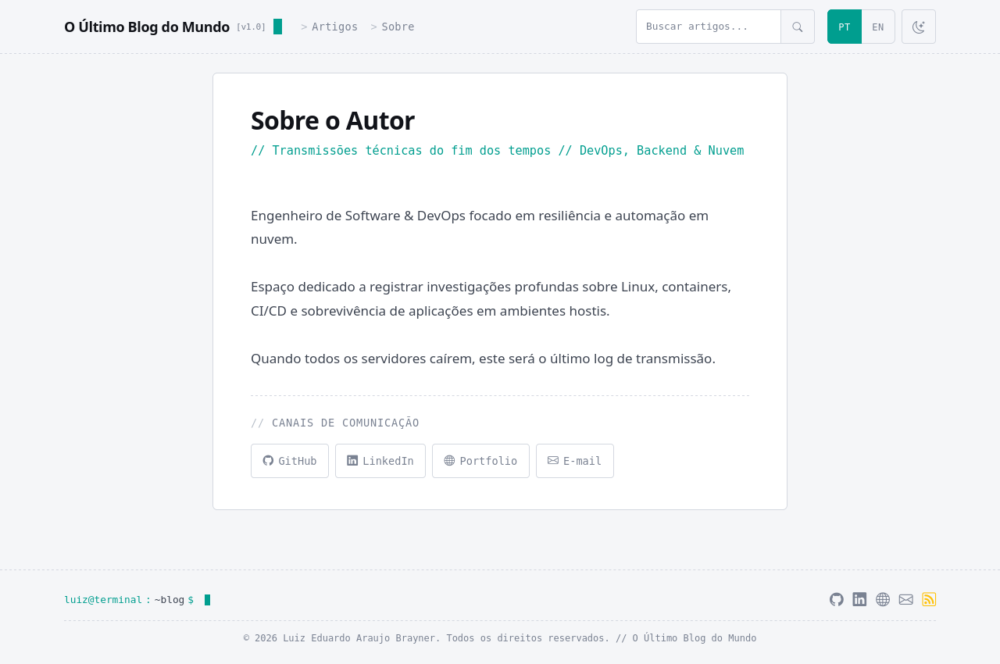
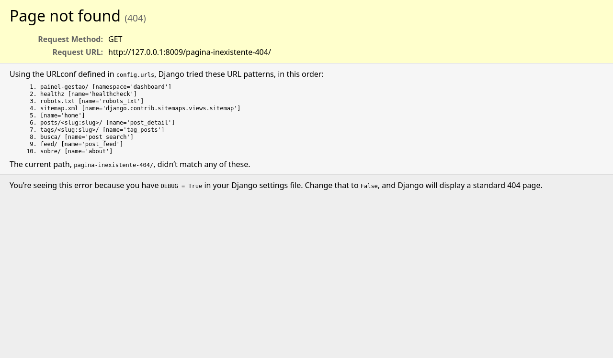
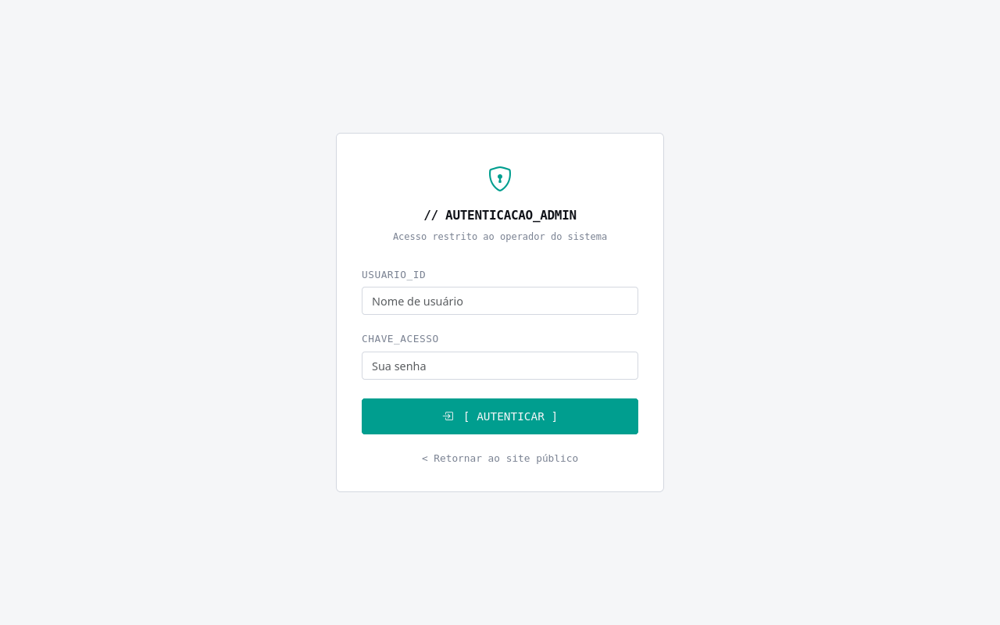
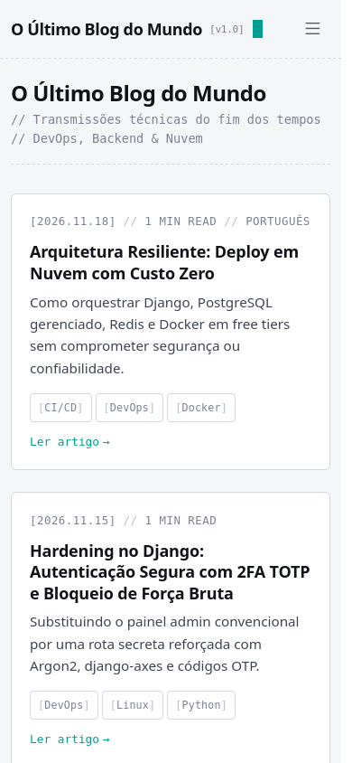

# O Último Blog do Mundo

> Blog pessoal de artigos técnicos + projeto de portfólio DevOps/Back-end.
> Construído com foco em resiliência, segurança, tipografia de alta densidade técnica e deploy em nuvem com **custo zero absoluto**.

[](https://github.com/Luiz-Edu0202/o-ultimo-blog-do-mundo/actions/workflows/ci.yml)
[](https://github.com/Luiz-Edu0202/o-ultimo-blog-do-mundo/actions/workflows/keep_alive.yml)
[](https://github.com/Luiz-Edu0202/o-ultimo-blog-do-mundo/actions/workflows/backup.yml)
[](LICENSE)
[](https://www.python.org/)
[](https://www.djangoproject.com/)
[](Dockerfile)

---

## 📋 Sobre o Projeto

**O Último Blog do Mundo** é o blog pessoal de Luiz Eduardo Araujo Brayner com dois propósitos complementares:

1. **Blog real** de engenharia de software e artigos técnicos escritos em Markdown, com interface bilíngue (Português e Inglês) e realce de sintaxe avançado.
2. **Projeto de portfólio para vagas de DevOps e Back-end sênior**, demonstrando arquitetura em camadas, Docker multi-stage, pipeline CI/CD completo, scans de vulnerabilidade automatizados, autenticação reforçada com 2FA TOTP e deploy automático em infraestrutura de nuvem moderna com **custo zero permanente**.

---

## 🏛️ Arquitetura do Sistema



---

## 📸 Demonstração Visual & Screenshots

O blog conta com uma identidade visual **Cyberpunk Suave / Terminal Retrô-Futurista** com tipografia de alta precisão servida localmente e responsividade total:

| Tela | Captura |
|---|---|
| **Home (Desktop Dark)** |  |
| **Leitura do Artigo (Tipografia & Syntax Highlight)** |  |
| **Sobre o Autor** |  |
| **Página 404 (ASCII Terminal)** |  |
| **Painel de Gestão (Login 2FA)** |  |
| **Mobile (iPhone 14 Viewport)** |  |

---

## 🛠️ Stack Tecnológica & Decisões Técnicas

| Camada | Tecnologia | Justificativa Técnica |
|---|---|---|
| **Linguagem & Framework** | Python 3.12 + Django 6.1.x | Framework maduro com ORM robusto, i18n nativo de primeira classe e excelente modelo de segurança. |
| **Driver PostgreSQL** | `psycopg[binary]` (psycopg3) | Driver oficial recomendado pelo Django 6.x com melhor suporte a tipagem e pooling nativo. |
| **Banco de Dados** | SQLite (Dev local) / PostgreSQL 16 (Prod) | SQLite local zero-setup; PostgreSQL 16 gerenciado no Supabase com PgBouncer connection pooler. |
| **Cache & Sessões** | Redis 7 (Upstash em prod) | Cache distribuído de alto desempenho e sessões isoladas com expiração segura de 8 horas. |
| **Armazenamento de Mídia** | Supabase Storage (S3 API) | Uploads de capas e mídia armazenados em bucket S3-compatível (`django-storages[s3]` + `boto3`). |
| **Servidor WSGI** | Gunicorn | Servidor UNIX padrão de mercado, estável e leve para ambientes containerizados. |
| **Arquivos Estáticos** | WhiteNoise | Serve arquivos estáticos com compressão Brotli/Gzip e hash de cache busting sem precisar de Nginx dedicado. |
| **Design System** | Space Grotesk + Inter + JetBrains Mono | Tipografia servida localmente (WOFF2) em tema claro/escuro nativo com tokens CSS e WCAG AA. |
| **Markdown & Sanitização** | Python-Markdown + Pygments + nh3 | Renderização rápida em cache com sanitização estrita via nh3 contra vulnerabilidades XSS. |
| **Qualidade & Lint** | Ruff + pytest-django + pre-commit | Ruff executa lint e formatação em milissegundos; pytest garante cobertura mínima de 80%. |
| **CI/CD** | GitHub Actions + GHCR | Pipeline com testes contra bancos reais, scans de vulnerabilidade (Trivy + pip-audit) e deploy automático. |
| **Deploy** | Render Web Service (Free Tier) | Deploy direto do Dockerfile multi-stage com disparo via webhook seguro. |

### Decisões Arquiteturais Fundamentais

- **Por que sem Django admin tradicional?**  
  O Django admin exposto é alvo frequente de scanners automatizados. O projeto substitui o admin padrão por um **painel customizado em rota secreta configurável** (`ADMIN_PATH`), protegido por **Argon2**, bloqueio de IP por força bruta (`django-axes`) e **2FA TOTP obrigatório**.
- **Por que sem Kubernetes neste projeto?**  
  Para o porte e perfil de tráfego de um blog pessoal, Kubernetes representaria complexidade acidental e custos de infraestrutura incompatíveis com a premissa de custo zero. A containerização via Dockerfile multi-stage + Compose local oferece portabilidade idêntica com footprint mínimo.
- **Por que fontes locais (WOFF2)?**  
  As fontes *Space Grotesk*, *Inter* e *JetBrains Mono* são servidas a partir de `static/fonts/`, garantindo independência de CDNs externas, conformidade com políticas restritivas de Content Security Policy (CSP) e carregamento sem latência de rede externa.

---

## 📁 Estrutura de Pastas

```
o-ultimo-blog-do-mundo/
├── config/                    # Configurações do projeto
│   ├── settings/
│   │   ├── base.py            # Configurações compartilhadas
│   │   ├── local.py           # Ambiente de dev (SQLite, DEBUG=True)
│   │   └── production.py      # Produção (Postgres, Redis, SSL/HSTS, CSP)
│   ├── urls.py                # Mapeamento raiz de URLs
│   ├── wsgi.py
│   └── asgi.py
├── apps/                      # Aplicações Django modulares
│   ├── core/                  # SiteConfig (singleton), healthcheck, views institucionais
│   ├── blog/                  # Modelos Post/Tag, feed RSS, sitemap, seed_demo
│   ├── dashboard/             # Painel customizado, 2FA TOTP, CRUDs de posts/tags/mídia
│   └── accounts/              # Gestão mínima de contas de operador
├── templates/                 # Templates HTML semânticos
├── static/                    # Arquivos estáticos (CSS modular, fontes locais WOFF2)
│   ├── css/                   # Design system modular (tokens, base, components, responsive)
│   └── fonts/                 # Space Grotesk, Inter, JetBrains Mono
├── locale/{pt_BR,en}/         # Arquivos de tradução (.po / .mo)
├── tests/                     # Suíte de testes automatizados (104 testes, 92.7% cobertura)
├── scripts/                   # Scripts utilitários (ex: take_screenshots.py)
├── docs/                      # Documentação operacional e screenshots
│   ├── backup_restore.md      # Procedimentos de backup, restauração e rollback
│   └── screenshots/           # Capturas de tela da aplicação
├── requirements/
│   ├── base.txt               # Dependências comuns
│   ├── local.txt              # Dependências de desenvolvimento
│   └── production.txt         # Dependências de produção
├── Dockerfile                 # Multi-stage build (builder -> final)
├── docker-compose.yml         # Ambiente local completo (web + postgres:16 + redis:7)
├── Makefile                   # Atalhos convenientes para desenvolvimento
├── pyproject.toml             # Configuração centralizada (Ruff, pytest, coverage)
└── .github/workflows/         # Pipelines CI/CD (ci.yml, keep_alive.yml, backup.yml)
```

---

## 🚀 Como Rodar Localmente

### Opção 1: Sem Docker (SQLite Local)

```bash
# 1. Clonar o repositório
git clone https://github.com/Luiz-Edu0202/o-ultimo-blog-do-mundo.git
cd o-ultimo-blog-do-mundo

# 2. Criar e ativar virtualenv
python3 -m venv .venv
source .venv/bin/activate  # No Windows: .venv\Scripts\activate

# 3. Instalar dependências de desenvolvimento
pip install -r requirements/local.txt

# 4. Configurar variáveis de ambiente
cp .env.example .env

# 5. Executar migrações e popular dados de exemplo
python manage.py migrate
python manage.py seed_demo  # Cria artigos, tags e SiteConfig realistas

# 6. Iniciar o servidor
python manage.py runserver
# Acesse: http://localhost:8000/
# Healthcheck: http://localhost:8000/healthz
```

### Opção 2: Com Docker Compose (PostgreSQL 16 + Redis 7)

```bash
# 1. Configurar variáveis de ambiente
cp .env.example .env

# 2. Subir os containers (Web + Postgres + Redis)
make up
# ou: docker compose up --build

# 3. Em outro terminal, aplicar migrações e dados de demonstração
make migrate
make seed-docker

# 4. Criar superusuário administrativo
docker compose exec web python manage.py createsuperuser

# Acesse:
# http://localhost:8000/           — Blog público
# http://localhost:8000/healthz   — Healthcheck JSON (DB + Redis ok)
```

### Atalhos Úteis do Makefile

| Comando | Descrição |
|---|---|
| `make run` | Inicia o servidor local de desenvolvimento (SQLite) |
| `make test` | Executa pytest com verificação de cobertura (mín. 80%) |
| `make lint` | Executa Ruff linter e checagem de formatação |
| `make seed` | Popula o banco local com artigos e dados de teste |
| `make up` | Constrói e inicia todos os containers Docker |
| `make down` | Para os containers e limpa os volumes |
| `make test-docker` | Executa a suíte de testes dentro do container Docker |

---

## 🔒 Segurança Implementada

O projeto foi submetido a uma rigorosa política de segurança:

- **Autenticação Reforçada**: Hasher primário **Argon2** (`argon2-cffi`); senhas não são armazenadas em formatos vulneráveis a GPU.
- **Autenticação em Duas Etapas (2FA TOTP)**: Obrigatória para acesso ao painel de gestão (`django-otp` + `qrcode`).
- **Defesa Contra Força Bruta**: `django-axes` monitora tentativas repetidas de login inválido e bloqueia temporariamente por IP.
- **Sem Django Admin**: Rota `/admin/` inexistente no roteador de URLs; acesso exclusivo via `ADMIN_PATH` secreto.
- **Headers de Produção**:
  - `SECURE_SSL_REDIRECT = True` (HTTPS obrigatório)
  - `SECURE_HSTS_SECONDS = 31536000` (HSTS com subdomínios e preload)
  - `SESSION_COOKIE_SECURE = True`, `SESSION_COOKIE_HTTPONLY = True`, `SESSION_COOKIE_SAMESITE = "Lax"`
  - `CSRF_COOKIE_SECURE = True`, `CSRF_COOKIE_HTTPONLY = True`
  - `X_FRAME_OPTIONS = "DENY"` (Proteção contra clickjacking)
  - `SECURE_REFERRER_POLICY = "same-origin"`
- **Sanitização de Conteúdo**: Todo HTML resultante de Markdown passa pela biblioteca **`nh3`**, permitindo apenas tags e atributos seguros e eliminando vetores de XSS.
- **Varredura Automatizada no CI**:
  - `pip-audit` audita dependências contra bancos de CVEs conhecidas.
  - **Trivy** analisa o sistema de arquivos e a imagem Docker construída antes do push.

---

## ⚠️ Limitações Conhecidas (Free Tiers) & Mitigações

Operar infraestrutura em nuvem moderna com **custo zero permanente** impõe restrições operacionais conhecidas dos provedores gratuitos:

1. **Spin-down do Render Free Tier**:
   - *Limitação*: O container entra em estado de dormência após 15 minutos sem requisições HTTP; a primeira requisição subsequente pode demorar ~45 segundos para responder (cold start).
   - *Mitigação*: Workflow agendado `.github/workflows/keep_alive.yml` executa um ping a cada 3 horas para minimizar a dormência em horários de pico.
2. **Pausa por Inatividade do Supabase Free Tier**:
   - *Limitação*: Projetos gratuitos no Supabase são pausados após 7 dias contínuos sem comandos de escrita.
   - *Mitigação*: O workflow `keep_alive.yml` e a rotina semanal de backup (`backup.yml`) garantem consultas ativas ao banco.
3. **Persistência de Mídia no Free Tier**:
   - *Limitação*: O disco local do container no Render é efêmero (reinicializações descartam o filesystem).
   - *Solução Arquitetural*: Nenhuma mídia é gravada localmente em produção; todos os uploads são enviados diretamente para o bucket S3 do Supabase Storage.

---

## 🔄 Rotinas de Operação, Backup e Rollback

Para instruções detalhadas de:
- Backup semanal e exportação de dumps com `pg_dump`;
- Restauração de desastre com `pg_restore`;
- Exportação de arquivos do Supabase Storage;
- Rollback para imagens e tags anteriores no Render;

Consulte o manual operacional em [`docs/backup_restore.md`](docs/backup_restore.md).

---

## 🗺️ Roadmap Futuro

- [ ] **Orquestração em Kubernetes**: Implantação em cluster bare-metal / k3s com Helm charts e GitOps via ArgoCD (projeto separado).
- [ ] **Stack de Observabilidade**: Exportador de métricas Prometheus, dashboards em Grafana e agregação de logs com Loki.
- [ ] **CDN de Borda**: Configuração de zona Cloudflare com cache de HTML dinâmico em edge workers.

---

## 🗺️ Status dos Milestones

- [x] **M1 — Fundação**: Estrutura modular, settings em camadas, CI esqueleto, Ruff e pre-commit
- [x] **M2 — Domínio Público**: Modelos Post/Tag, i18n bilíngue, Markdown sanitizado, busca, RSS, sitemap e SEO
- [x] **M3 — Dashboard**: Rota secreta, autenticação 2FA TOTP, bloqueio com django-axes, CRUDs de posts/tags/mídia
- [x] **M4 — Docker**: Dockerfile multi-stage, docker-compose local, healthcheck /healthz e Makefile
- [x] **M5 — Produção**: Supabase Postgres + S3, Upstash Redis, deploy automatizado no Render e keep-alive
- [x] **M6 — Identidade Visual & Mobile**: Tipografia Space Grotesk/Inter/Mono, paleta terminal retrô-futurista, offcanvas mobile
- [x] **M7 — Polimento**: Acessibilidade WCAG AA (reduced motion, contraste, focus ring), testes finais (104 testes), screenshots e release v1.0.0

---

## 📄 Licença

Distribuído sob licença MIT. Veja [`LICENSE`](LICENSE) para mais detalhes.
