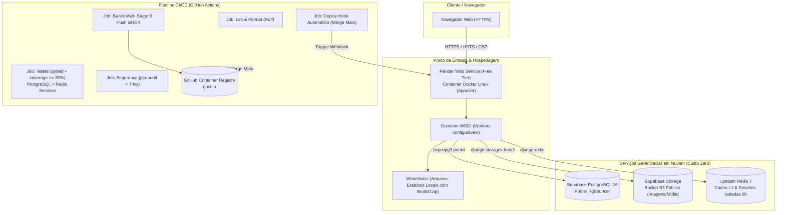

# 🏛️ Arquitetura do Sistema — O Último Blog do Mundo

> [English Version](en/architecture.md) | **Português**

Este documento detalha a topologia de infraestrutura, o fluxo de dados e as decisões de engenharia adotadas na arquitetura do **O Último Blog do Mundo**, projetada para resiliência operacional e conformidade com limites de **custo zero permanente**.

---

## 1. Diagrama de Arquitetura

---

## 2. Topologia de Camadas e Serviços

### 2.1 Camada de Aplicação & Hospedagem
- **Hospedagem**: Render Web Service executando sobre container Docker Linux em usuário sem privilégios (`appuser` com UID 1000).
- **Servidor WSGI**: Gunicorn gerenciando workers síncronos com timeouts ajustáveis via variáveis de ambiente (`GUNICORN_WORKERS`, `GUNICORN_TIMEOUT`, `PORT`).
- **Arquivos Estáticos**: Servidos diretamente pela aplicação através do **WhiteNoise**, com manifesto de cache-busting, compressão automática Brotli e Gzip, sem necessidade de intermediar um proxy reverso Nginx dedicado.

### 2.2 Camada de Dados & Persistência
- **Banco de Dados Relacional**: PostgreSQL 16 hospedado no Supabase.
  - Conexão configurada através do pooler de conexões PgBouncer (`aws-0-us-east-1.pooler.supabase.com:5432`).
  - Configuração Django com `DISABLE_SERVER_SIDE_CURSORS = True` para total compatibilidade com transaction pooling do PgBouncer.
- **Cache Distribuído & Sessões**: Redis 7 gerenciado pelo Upstash com conexão criptografada (TLS).
  - Utilizado como backend de sessões com expiração de 8 horas para logins administrativos.
  - Cache de renderização Markdown em memória reduzindo o processamento no backend.
- **Armazenamento de Mídia**: Supabase Storage via API compatível com Amazon S3.
  - Integração via `django-storages[s3]` e `boto3`.
  - Capas de artigos e imagens da biblioteca de mídia são enviadas para bucket público com URLs imutáveis, eliminando perda de dados em containers efêmeros.

---

## 3. Decisões Técnicas Justificadas

### Por que Django 6.1.x?
Django é uma plataforma madura com segurança testada em batalha (proteções embutidas contra CSRF, SQL Injection e Clickjacking), suporte nativo a internacionalização (`i18n_patterns` e arquivos `.po`) e um ORM expressivo. A versão 6.1.x traz suporte estendido até ~2028, melhor tipagem e alinhamento com bibliotecas modernas.

### Por que driver `psycopg3` (`psycopg[binary]`)?
É o driver oficial recomendado pela documentação do Django 6.x para conexões PostgreSQL, trazendo suporte nativo a tipos Python modernos, melhor gerenciamento de conexões e desempenho superior em comparação ao legado `psycopg2`.

### Por que um Painel Customizado sem o Django Admin Tradicional?
O Django admin tradicional em `/admin/` é o primeiro alvo visado por bots maliciosos e scripts de força bruta na internet pública. O projeto desativa `admin.site.urls` e constrói um painel administrativo sob medida em rota secreta configurável (`ADMIN_PATH`), protegido por Argon2, 2FA TOTP e rate-limiting por IP.

### Por que sem Kubernetes no escopo atual?
Para uma aplicação com o perfil de um blog pessoal, orquestrar Kubernetes (Helm, ArgoCD, HPA, ingress controllers) agregaria complexidade operacional desnecessária e exigiria clusters gerenciados que extrapolam o free tier. O uso de Docker multi-stage com `docker-compose` atinge isolamento e portabilidade equivalentes sem custos recorrentes.

---

## 4. Design System & Tipografia

A identidade visual adota a estética **Cyberpunk Suave / Terminal Retrô-Futurista**, estruturada em CSS nativo sem frameworks pesados de runtime:
- **Fontes Servidas Localmente**:
  - `Space Grotesk` (Medium 500, Bold 700) para títulos e hierarquia de display.
  - `Inter` (Regular 400, Medium 500, SemiBold 600) para leitura de texto fluido.
  - `JetBrains Mono` (Light 300, Regular 400) para código, metadados e elementos de terminal.
- **Paleta de Cores & Design Tokens (`static/css/tokens.css`)**:
  - Modo escuro com fundo `#0A0C10` e acento ciano `#00E5CC`.
  - Modo claro calibrado para conformidade com **WCAG AA** (contraste mínimo de 4.5:1).
  - Suporte automático a `prefers-color-scheme` e alternância persistida em `localStorage`.
