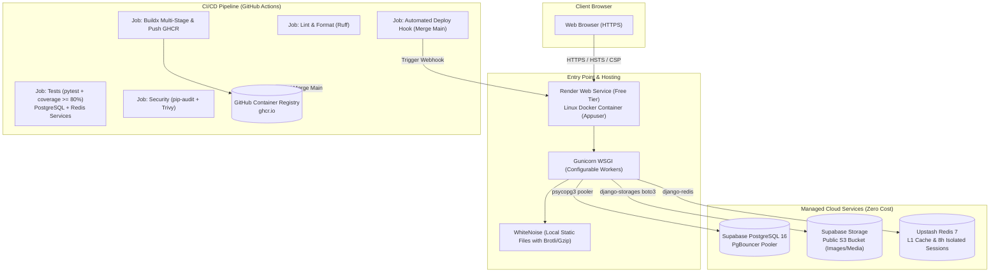

# 🏛️ System Architecture — The Last Blog in the World

> **English** | [Versão em Português](../architecture.md)

This document details the infrastructure topology, data flows, and engineering decisions behind **The Last Blog in the World**, designed for high operational resilience and strict compliance with a **permanent zero-cost** policy.

---

## 1. Architecture Topology Diagram

---

## 2. Infrastructure Layers & Services

### 2.1 Application & Hosting Layer
- **Hosting**: Render Web Service running a Linux Docker container under an unprivileged user (`appuser` with UID 1000).
- **WSGI Server**: Gunicorn managing synchronous workers with configurable timeouts via environment variables (`GUNICORN_WORKERS`, `GUNICORN_TIMEOUT`, `PORT`).
- **Static Assets**: Served directly by the application using **WhiteNoise**, with cache-busting manifests, automated Brotli and Gzip compression, eliminating the need for a separate Nginx reverse proxy.

### 2.2 Data & Persistence Layer
- **Relational Database**: PostgreSQL 16 hosted on Supabase.
  - Connection routed through the PgBouncer transaction connection pooler (`aws-0-us-east-1.pooler.supabase.com:5432`).
  - Django configured with `DISABLE_SERVER_SIDE_CURSORS = True` for full compatibility with PgBouncer transaction pooling.
- **Distributed Cache & Sessions**: Redis 7 managed by Upstash over encrypted TLS.
  - Used as the session backend with strict 8-hour expiration for admin logins.
  - In-memory caching for Markdown rendering to minimize backend CPU overhead.
- **Media Storage**: Supabase Storage via an Amazon S3-compatible API.
  - Integrated via `django-storages[s3]` and `boto3`.
  - Article cover images and media library assets are stored in a public bucket with immutable URLs, preventing data loss on ephemeral container restarts.

---

## 3. Justified Engineering Decisions

### Why Django 6.1.x?
Django provides battle-tested built-in security (CSRF, SQL Injection, Clickjacking protections), first-class native internationalization (`i18n_patterns` and `.po` catalogs), and an expressive ORM. Version 6.1.x provides extended support through ~2028, superior typing, and alignment with modern Python libraries.

### Why the `psycopg3` driver (`psycopg[binary]`)?
It is the officially recommended driver in Django 6.x for PostgreSQL, offering native support for modern Python types, superior connection management, and better performance compared to the legacy `psycopg2`.

### Why a Custom Management Dashboard without Standard Django Admin?
The default Django admin at `/admin/` is a prime target for automated credential stuffing and dictionary attacks on the open internet. The project disables `admin.site.urls` and replaces it with a tailor-made admin dashboard at a configurable secret path (`ADMIN_PATH`), reinforced with Argon2, mandatory 2FA TOTP, and IP-based rate limiting.

### Why no Kubernetes in the current scope?
For a personal blog, Kubernetes (Helm, ArgoCD, HPA, ingress controllers) would introduce accidental complexity and hosting costs incompatible with zero operating cost. Multi-stage Docker packaging combined with Docker Compose provides identical portability without financial overhead.

---

## 4. Design System & Typography

The visual identity follows a **Soft Cyberpunk / Retro-Futuristic Terminal** aesthetic, built purely with native CSS custom properties:
- **Locally-Served Web Fonts**:
  - `Space Grotesk` (Medium 500, Bold 700) for display headers.
  - `Inter` (Regular 400, Medium 500, SemiBold 600) for reading text.
  - `JetBrains Mono` (Light 300, Regular 400) for code, metadata, and CLI prompts.
- **Design Tokens (`static/css/tokens.css`)**:
  - Dark mode with abyssal background `#0A0C10` and cyan phosphor accent `#00E5CC`.
  - Light mode calibrated for **WCAG AA** compliance (minimum 4.5:1 contrast).
  - Native support for `prefers-color-scheme` with persistence in `localStorage`.
